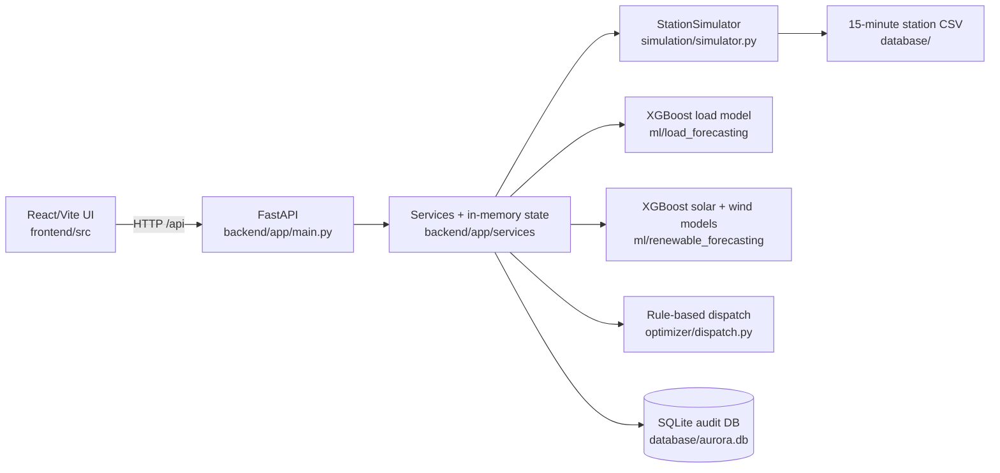
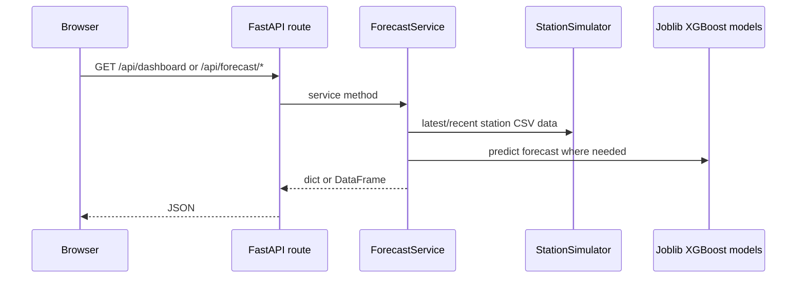
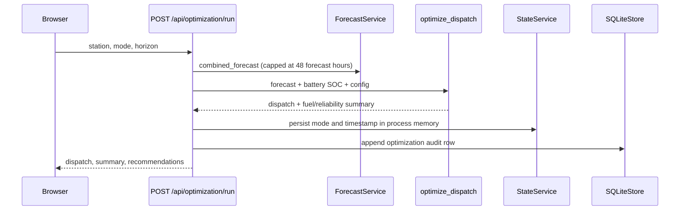

# AURORA project graph

> **Purpose:** Read this file before changing the code. It is a compact, code-backed map of AURORA—the SIH26061 polar-station energy-management prototype.

## 1. What this repository does

AURORA forecasts station electricity demand and renewable supply, exposes results and dispatch recommendations through a FastAPI API, and displays them in a React/Vite dashboard. It is a **demonstration prototype**: its load data is synthetic/development data and the API currently executes a rule-based dispatch fallback, not the included MILP class.



## 2. Navigate by responsibility

| Area | Start here | Key dependencies / notes |
| --- | --- | --- |
| API composition | `backend/app/main.py` | Registers every `/api` router and CORS for Vite. |
| API shared objects | `backend/app/api/dependencies.py` | Constructs singleton forecast/services and SQLite store at import time. |
| Forecasting | `backend/app/services/forecast_service.py` | Central integration point for simulator and all three serialized ML models. Horizons are hours, converted to 15-minute steps. |
| Live/dashboard data | `backend/app/services/{dashboard,energy,fuel,battery,alert,state}_service.py` | `state_service.py` is process-local mutable state; it is not persistent. |
| Dispatch | `optimizer/dispatch.py` | API calls `optimize_dispatch()` (heuristic). `EnergyOptimizer` is an unused OR-Tools MILP implementation. |
| Simulation | `simulation/simulator.py` | CSV reader/filter; `recent(hours)` currently returns that many **rows**, not hours. |
| ML training | `ml/data/generate_synthetic.py`, `ml/load_forecasting/train.py`, `ml/renewable_forecasting/train.py` | Produces model artifacts that backend loads. |
| UI entry/data loading | `frontend/src/App.jsx`, `frontend/src/services/api.js` | App refreshes dashboard + forecasts every 15 s. API base and mock mode use `VITE_*` variables. |
| UI presentation | `frontend/src/pages/`, `frontend/src/components/` | Components are presentational; `App.jsx` holds primary client state. |
| Containers | `docker/docker-compose.yml`, `docker/*.Dockerfile` | Two services: backend on 8000 and Nginx-served frontend on 5173. |

## 3. Runtime flows

### Read flow



### Optimization flow



## 4. HTTP contract

All endpoints are prefixed with `/api` (see `backend/app/main.py`).

| Method | Path | Handler/service |
| --- | --- | --- |
| GET | `/health` | process health check |
| GET | `/dashboard?station=` | `DashboardService.snapshot` |
| GET | `/energy/live?station=` | `EnergyService.live` |
| GET | `/forecast/load?station=&horizon=1..168` | `ForecastService.load_forecast` |
| GET | `/forecast/renewable?station=&horizon=1..168` | `ForecastService.renewable_forecast` |
| POST | `/optimization/run` | `OptimizationService.run` |
| GET | `/fuel/status?station=` | `FuelService.status` |
| GET | `/battery/status?station=` | `BatteryService.status` |
| GET | `/alerts?station=` | `AlertService.build` |
| POST | `/simulation/scenario` | `StateService.set_scenario` |

**When changing an API response:** update the route/schema, its service, `frontend/src/services/api.js`, then every consuming page/component. Keep backend snake_case ↔ frontend camelCase translations explicit in `api.js`.

## 5. Data and artifact contracts

```text
CSV dataset
  -> StationSimulator and ML feature/training code
  -> .joblib models + JSON metrics under ml/
  -> ForecastService
  -> dashboard / forecast / optimization API responses
```

Backend configuration in `backend/app/core/config.py` expects:

- `database/AURORA_Maitri_15min_Forecasting_Dataset.csv`
- `ml/models/load_xgb_15min.joblib`
- `ml/models/solar_xgb_15min.joblib`
- `ml/models/wind_xgb_15min.joblib`

The full CSV is gitignored; only a `.bak_2025` file is present in this checkout. A backend started without the expected CSV will fail while importing API dependencies. Do not silently replace this with fake production telemetry.

## 6. Important constraints and known gaps

1. **Synthetic-data boundary:** never describe generated/development load data as measured Bharati/Maitri telemetry.
2. **Forecast weather fallback:** future renewable features persist the last observation when a matching historical timestamp is unavailable; production needs a weather provider.
3. **Optimization:** `OptimizationService` intentionally calls the heuristic fallback. OR-Tools is not listed in `backend/requirements.txt`, so wiring in `EnergyOptimizer` needs dependency, solver, result-contract, and tests work.
4. **Time units:** models and dispatch use 15-minute intervals. Be careful: heuristic battery/fuel updates do not multiply power by `0.25`, while the MILP does.
5. **State lifecycle:** scenarios, mode, SOC, and fuel live only in the backend process. Only optimization audit rows go to SQLite.
6. **Station behavior:** when the CSV lacks a `station` column or a requested station has no rows, simulator falls back to the full dataset.

## 7. Change playbooks

- **Add an endpoint:** create a route in `backend/app/api/routes/`, include it in `main.py`, use/add a service, update `api.js`, and add a backend test in `backend/tests/`.
- **Change forecasting:** inspect feature creation plus model artifact compatibility; retrain affected models and update artifact/metric documentation.
- **Change dispatch:** preserve `combined_forecast` columns (`timestamp`, `load_kw`, `solar_kw`, `wind_kw`, `critical_load_kw`, `flexible_load_kw`) and API summary keys consumed by `api.js`.
- **Change a dashboard value:** trace `App.jsx` → `api.js` → route → service before editing presentation code.

## 8. Local verification

```bash
# Backend (requires the configured CSV and model artifacts)
cd backend && source .venv/bin/activate
uvicorn app.main:app --reload --port 8000
curl http://localhost:8000/api/health

# Frontend
cd frontend
npm run build
npm run dev
```

No root-level test runner is configured. Add focused tests alongside changes, especially for API contracts, time-step units, and dispatch edge cases.

## 9. Keep this graph current

Update this file in the same change when altering entry points, API contracts, data/artifact paths, runtime topology, or the limitations above. Prefer paths and verified behavior over aspirational architecture.
